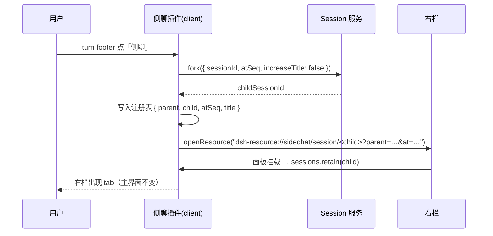
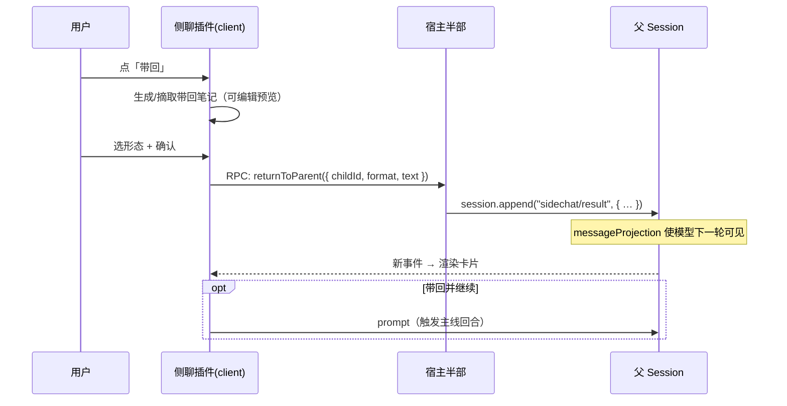

# 侧聊（Side Chat）插件设计

- 状态：draft v0.1
- 日期：2026-10-28
- 目标包名：`dsh-side-chat`
- 宿主：DSH 0.2.1-rc.2 · Web GUI（`http://127.0.0.1:3080`）
- 目标：把 DSH 已有的 `session/fork` 重新宿主到右栏，并补上「选区引用」与「结论带回」两条通道。

---

## 0. TL;DR

1. **侧聊就是一条纯分支会话**：`session/fork` 在某个已完成 turn 的边界复制事件前缀，得到一个普通 session。没有新的会话类型、没有活共享、没有父子联动的日志。
2. **隔离是结构性的**：主线之后的新消息不会进入侧聊，侧聊的消息也不会进入主线，两条侧聊之间除了「同一个工作目录 + 同一份额度」之外没有任何耦合。
3. **带回是显式的、手动的、可编辑的**：结论由侧聊自己的模型在现场生成（或取原文），经预览确认后，以一条自定义事件追加到主线日志，模型能在下一轮看到。
4. **选区引用是必需项**

---

## 1. 背景

### 1.1 Codex 侧聊在解决什么

长线程的两个必然问题：上下文越来越贵、话题越来越偏。侧聊给出的解法是：

- 从当前线程**复制一份快照**开旁支，旁支知道前文，但旁支的对话**不回灌**主线；
- 在旁支里问「这函数干什么」「有几种方案」「这段报错什么意思」，问完把结论**手动**带回；
- 主线上下文全程干净，分支用完即弃。

本质是**上下文卫生**加**分支判断**，而不是「多一个聊天窗口」。

### 1.2 DSH 现有能力盘点

| 能力 | 现状 | 位置 |
| --- | --- | --- |
| 从某条消息/某轮分叉 | ✅ 已内建，`fork({ sessionId, atSeq })`，turn footer 有 branch 动作 | `dsh-api-session-controller`（`session/fork`） |
| 分叉语义正确 | ✅ 复制「精确包含式前缀」，含 turn 中间截断、inherited marker、补全 open step 的缺失工具结果 | `dsh-session` / `buildForkSeed` |
| 右栏 tab 宿主 | ✅ 每个 session 一个 docking surface，支持 push / fullscreen / split / float / dock | `dsh-client-ui-sidebar-right` |
| 右栏内嵌完整 Chat | ✅ 已有实现可抄（子代理聊天） | `dsh-client-ui-subagent` |
| 人在右栏直接提问 | ✅ 内嵌的就是 `conversation.content`，含输入框、模型选择、Stop | `dsh-client-ui-conversation` |
| fork 后不跳走 | ❌ 内置 branch 会 `uiWorkspace.openSession` 切走主界面 | `dsh-client-ui-chat` |
| 侧聊身份（入口/标题/布局持久化） | ❌ 无 | — |
| 结论带回通道 | ❌ 无 | — |
| 选区引用 | ⚠️ 有文件/文件夹/Session 引用 chip，无「选中文本引用」 | `dsh-client-ui-conversation` |
| 自定义会话事件 → 卡片 | ✅ 可用 `registerMessageProjection` + Conversation Definition | `dsh-session` / `dsh-client-ui-conversation` |

### 1.3 本文的取舍

只做**重新宿主 + 两条通道 + 若干差异化**，不改 DSH 核心，不引入新的会话类型，不复制 Chat 渲染器。

---

## 2. 核心定义

### 2.1 侧聊 = 纯分支会话

一个侧聊在数据层就是一个普通 session：

- 有独立 `sessionId`、独立事件日志、独立 Agent 实例、独立上下文与 token 账本；
- 通过 `parentSessionId` 记录血缘（fork origin，不是 subagent origin）；
- 可以在会话列表里被看到、被归档、被恢复、被切模型；
- 可以继续 fork 出它自己的侧聊（形成树）。

插件只做三件附加的事：**给它一个右栏的家、给它一个标题与徽标、给它一条回主线的通道**。

### 2.2 三个不变量

| 不变量 | 含义 | 后果 |
| --- | --- | --- |
| **快照隔离** | fork 在时刻 T 复制前缀，之后双向都不流动 | 主线后续进展侧聊看不见；需要时提供「同步最新主线」手动操作 |
| **日志只追加** | 带回内容写在主线**尾部**，不改写历史 | 「挂到分叉点下面」只能是 UI 装饰与跳转，不是日志位置 |
| **带回必须显式** | 没有任何自动回灌 | 用户永远知道主线被塞了什么、塞在哪 |

### 2.3 与相邻概念的边界

| | Branch（内置） | **侧聊（本插件）** | Subagent 子会话 |
| --- | --- | --- | --- |
| 底座 | fork session | **fork session** | fork/spawn 子代理 |
| 打开位置 | 主界面（跳走） | **右栏 tab（不跳走）** | 右栏 subagent 面板 |
| 谁驱动 | 人 | **人** | 父 agent 通过工具派活 |
| 上下文 | 快照 | **快照** | 任务种子 |
| 结果如何回主线 | 人自己搬 | **显式带回事件** | 结算通知（自动） |
| 数量上限 | 无 | 每父会话建议 ≤4 | `maxActiveSubagents` 默认 8、`maxDepth` 1 |
| 语义 | 「从这儿重新开始」 | **「从这儿旁支思考，结论回来」** | 「派出去做一件事」 |

选择 fork 而不是 subagent 的理由：侧聊是**人驱动的平行思考**，不是**父 agent 派出去执行的任务**。subagent 有任务框架、深度限制、结算通知语义，且其 UI 是围绕「代理工作过程」而非「对话」设计的。

---

## 3. 三个关键问题

### 3.1 隔离性：主线新消息会进来吗？两条侧聊会打架吗？

**不会。三层原因：**

1. fork 是**复制**不是引用。子会话拿到的是父日志在 `atSeq` 处的前缀副本，父会话之后的任何事件都不会出现在子会话里。反过来同理。
2. 每个 session 有自己的 Agent、上下文组装、token 账本、模型选择。两条侧聊可以一个用便宜模型、一个用强模型，互不影响。
3. 并发写入按 session 隔离，日志各自追加，不存在「谁插到谁的对话里」。

**唯一的真实共享是执行环境：**

| 共享物 | 影响 | 缓解 |
| --- | --- | --- |
| 同一个工作目录 / 文件系统 | 两条侧聊同时改同一文件会互相覆盖 | 「咨询模式」默认只读；并行时提示「它们在同一个目录」 |
| 工具权限 / 审批策略 | 侧聊能做的事情和主线一样多 | 可选只读 preset 或 `tools/pre-execute` 拦截 |
| 账号额度 | 并行侧聊更快烧 token | tab 上显示本侧聊的 token，父会话徽标汇总 |
| 模型并发限流 | 极端情况下排队 | 队列自然退避，UI 不需要特殊处理 |

**「纯分支会话」正是本设计的主张**：所有隔离性来自 fork 本身，插件不引入任何耦合机制。

**唯一可选的例外（默认关闭）**：「同步主线最新进展」——把 fork 之后主线新增的消息压成一条 digest，追加到侧聊尾部，让侧聊「追上进度」。这是一次显式操作，不是活共享。

### 3.2 带回主线怎么做？结论是压缩完的吗？手动添加吗？

**三个维度分开看。**

**（a）结论从哪来：三个来源，默认第一个**

| 来源 | 行为 | 成本 |
| --- | --- | --- |
| 侧聊模型生成带回笔记（默认） | 在侧聊里跑一次短回合：「把上面的结论整理成带回主线的笔记，格式 X」 | 1 次短模型调用，质量最好（它拥有完整上下文） |
| 取最后一条回复原文 | 直接摘最后一条 assistant 消息 | 0 额外调用，适合「结论就是那段回答」 |
| 用户手写 | 空编辑器 | 0 调用 |

所以「结论是压缩完的吗」——**是，但压缩发生在侧聊里，由侧聊自己的模型现场做**，不是插件做机械截断。用户可以在预览里改到满意为止。

**（b）手动还是自动：始终手动**

点「带回」→ 弹预览 → 选形态与落点 → 确认。没有任何自动回灌。可选的辅助只是「侧聊答完时给 tab 打角标、发一条 1 秒 toast」，绝不自动插入主线。

**（c）落到哪里、以什么身份出现**

- 追加到**主线日志尾部**（不可变日志只能追加），UI 卡片上带「来自第 N 轮侧聊」的锚点链接，点击可跳回侧聊、也支持从分叉点徽标反向打开。
- 身份是**自定义事件 `sidechat/result`**，不是 user 消息。经 `registerMessageProjection` 投影后模型能看到，语义上是一条「侧聊结论」，不会让模型误判为「用户刚说过这话」。
- 两种发送语义要区分清楚：
  - **带回（默认）**：只写事件，不触发主线回合。模型在下一轮自然看到。
  - **带回并继续**：写事件后立刻向主线发一条 prompt，让主线基于结论继续干活。

**（d）形态预设**

| 形态 | 用途 |
| --- | --- |
| 摘要卡片 | 默认，3–6 行 |
| 决策清单 | 「选 A 而不是 B，因为…」 |
| TODO | 立刻可执行的条目，可选同时转成 goal/待办 |
| 补丁片段 | 代码块，不自动写入文件 |
| 一句话结论 | 「就用方案 2」 |

### 3.3 选区引用

| 方向 | 交互 | 实现 |
| --- | --- | --- |
| 主线 → 已开的侧聊 | 选中正文 → 浮动「引用到侧聊」→ 插入该侧聊输入框（`> ` 引用块 + 来源锚点） | `InputActions.captureInsertion()` + `insertText(text, span)` |
| 主线 → 新侧聊 | 选中 → 「就这段开侧聊」→ 新建 + 引用进首条草稿（不自动发送） | fork + `requestDraftInitialization` 或首条消息预填 |
| 侧聊 → 主线输入框 | 侧聊里选中 → 「引用回主线」 | 同一套 `InputActions` |

要点：

- 选区限定在 Chat 容器内，用 `window.getSelection()` 取文本与锚点（消息 id / seq）；
- 代码片段自动带 `@path:line`（复用 DSH 已有的 file mention 能力）；
- Lexical 编辑器的插入是 span-CAS 的，异步插入可能失败（用户在此期间改了草稿）。失败时**降级为「直接作为新消息发出」**，不静默丢弃；
- 明确不做：拖拽 DOM 片段、跨 iframe 选区、图片选区引用。

---

## 4. 功能清单

### 4.1 MVP（做完即可日常使用）

| # | 功能 | 说明 |
| --- | --- | --- |
| M1 | 从任意已完成 turn 开侧聊 | turn footer 按钮 + 命令面板；`atSeq` 即该 turn 的 closing seq |
| M2 | 右栏承载全功能 Chat | 复用 `conversation.content` embedded 变体，输入框/模型/Stop/折叠全有 |
| M3 | 侧聊身份 | tab 标题「侧聊 · 主线标题 · 第 N 轮」；来源消息可点击回主线定位 |
| M4 | 带回 | 弹窗预览 + 形态选择 + 可编辑；写 `sidechat/result` 事件 |
| M5 | 异步角标 | 侧聊回合结束 → tab 角标 + 轻提示，不打断主线 |
| M6 | 结束即归档 | 可选归档；tab 关闭不销毁，可从 guide 或徽标恢复 |
| M7 | 选区引用 | 主线 → 侧聊输入框；一个可用的最小实现即可 |

### 4.2 差异化（「比 Codex 多一点」）

| # | 功能 | 为什么值得做 | 复杂度 |
| --- | --- | --- | --- |
| D1 | 并行侧聊 + 对比视图 | 同一个问题问 3 个模型/3 种问法，右栏并排，挑一个带回。右栏本来就支持 split，几乎免费 | 中 |
| D2 | 上下文裁剪 | 全量 / 最近 k 轮 / 只选中的几条 / 不继承。比 Codex 的全量快照更省更聚焦 | 中 |
| D3 | 带回形态与落点可选 | 摘要/清单/TODO/补丁/一句话，落尾部或挂分叉点 | 低 |
| D4 | 侧聊独立模型档位 | 便宜模型问小事、强模型攻难点。fork 子是普通会话，切模型现成 | 低 |
| D5 | 分叉点徽标 | 主线里那条消息显示「2 个侧聊」+ 最近结论，一点重开 | 低 |
| D6 | 升级路径 | 侧聊 → 正式主线（adopt）/ 正式任务（goal、todo） | 中 |
| D7 | 同步最新主线 | fork 之后主线又跑了很多轮？手动把新进展压成 digest 追加进侧聊 | 低 |

### 4.3 远期

| # | 功能 | 说明 |
| --- | --- | --- |
| L1 | agent 自己开侧聊 | `side_chat` 工具：主线遇到不确定方案时自己分支试错，只把结论带回来。上下文卫生的自动化 |
| L2 | 只读咨询模式 | 侧聊默认禁写（不改文件、不跑有副作用命令），靠 preset 或 `pre-execute` 拦截 |
| L3 | 侧聊树 | 侧聊还能开侧聊，右栏面包屑 + 小树 |
| L4 | 导出 | 一条侧聊 → markdown 笔记 |

---

## 5. 架构

### 5.1 包结构

```
dsh-side-chat/
├─ package.json          # dsh.bundle.patch + dsh.client(platform: web)
├─ cordis.patch.yml      # 往 profile 配置树 insert 一行
├─ lib/
│  ├─ index.js           # 宿主半部：事件、投影、注册表、工具、归档
│  ├─ client.js          # 浏览器半部：tab 类型、面板、入口、引用、带回 UI
│  └─ ...
└─ docs/design.md
```

第三方插件契约：

- `dsh.bundle.patch` 指向 `./cordis.patch.yml`，patch 里 `- insert: [{ id, name, config }]` 插一行；
- `dsh.client` 声明 `platform: "web"`、`inject` 列出依赖的 client 包、`external` 只加非基线请求；
- 构建必须产出 `lib/client.js`，否则 activation 失败。

### 5.2 用到的扩展点

| 扩展点 | 属于 | 用途 |
| --- | --- | --- |
| `session/fork`（`ctx.sessions.fork`） | `dsh-api-session-controller` | 生成分支 |
| `ctx.sessions.retain(id, { source })` | 同上 | 在 tab 里持有子会话引用 |
| `ctx.resources.register` | Client 资源注册表 | 定义 `dsh-resource://sidechat/...` 协议 |
| `ctx.sidebarRightTabs.register` | `dsh-client-ui-sidebar-right` | 注册 tab 类型、标题、guide 入口 |
| `ctx.sidebarRight.openResource / openTab / toggleFullscreen / split` | 同上 | 打开、分屏、全屏 |
| `sidebar.right.pane.tab` 槽位 | 同上 | 面板主体 |
| `conversation.content` Factory | `dsh-client-ui-conversation` | 嵌入完整 Chat |
| `conversation.session.header.corner` | 会话 header | 备用入口按钮 |
| `conversation.chat.turnTail`（list） | `dsh-client-ui-chat` | 每个已完成 turn 的「侧聊」按钮，owner 直接给 `seq` |
| `conversation.chat.node` + `ChatNodeDataMap` 合并 | `dsh-client-ui-chat` | 自定义节点渲染（带回卡片） |
| `ConversationDefinitionRegistry` | `dsh-client-ui-conversation` | 把 `sidechat/result` 事件变成节点 |
| `@messageProjection` + `ctx.sessions.registerMessageProjection` | `dsh-session` | 让模型看到带回内容 |
| `session.append(type, data)` | `dsh-session` | 写自定义事件 |
| `ctx.storageDomain` | `dsh-storage` | 侧聊注册表持久化（非 session 数据） |
| `ctx.sessionProjections` | `dsh-session-projection` | 主线徽标 / 子会话 origin |
| `WorkspaceRegistry.archiveSession` | `dsh-workspace` | 归档（受 activity 门禁） |
| `InputActions.setDraft / insertText / captureInsertion` | `dsh-client-ui-conversation` | 引用注入 |
| `defineTool` + `ctx.tools.register` + `tools/pre-execute` | `dsh-tools` | `side_chat` 工具与权限门 |

### 5.3 开侧聊时序



关键一行：**不调用 `uiWorkspace.openSession`**。这是与内置 Branch 的唯一行为差别。

### 5.4 带回时序



### 5.5 引用注入路径

```
选区 → { text, anchorSeq, path?:line }
     → 目标侧聊的 InputActions
     → captureInsertion() 取 span
     → insertText("> " + text + "\n\n——来自第 N 轮", span)
     → 失败则降级为「作为新消息发送」
```

`InputActions` 是 session 作用域槽位组件的公开面，拿到它需要注册一个 session 作用域的槽位（如 `conversation.composer.dock`）。

---

## 6. 数据模型

### 6.1 资源地址

```
dsh-resource://sidechat/session/<childSessionId>?parent=<parentSessionId>&at=<seq>
```

- `kind: "sidechat"`，`priority: "extension"`；
- `canOpen` 用 `parseSideChatAddress` 校验；
- `title` 从注册表读，回退到 session 标题。

### 6.2 注册表（`ctx.storageDomain`）

```ts
interface SideChatRecord {
  childSessionId: string
  parentSessionId: string
  atSeq: number            // 分叉点
  title: string
  createdAt: number
  status: 'open' | 'archived'
  model?: string
  returns: Array<{ seq: number; format: string; at: number }>  // 已带回的记录
}
```

为什么不用 session 事件存：注册表是**插件侧非会话状态**，不该进模型上下文，也不该产生日志噪音。

### 6.3 自定义事件

```ts
// 写到父会话
'sidechat/result': {
  childSessionId: string
  childTitle: string
  atSeq: number
  format: 'summary' | 'decisions' | 'todos' | 'patch' | 'one-liner'
  text: string
}
```

- 通过 `@messageProjection` 投影成一条来源明确的 message（source 形如 `sidechat`），**不是** user 消息；
- 客户端通过 `ConversationDefinitionRegistry` 注册同名的节点定义，渲染成卡片；
- 无法渲染时（旧版本客户端）退化为一条普通文本消息，不丢内容。

### 6.4 投影

| 作用域 | key | 内容 |
| --- | --- | --- |
| 父会话 | `sidechat` | `{ count, lastReturnedAt, lastTitle }`，驱动分叉点徽标与 header 计数 |
| 子会话 | `sidechat` | `{ role: 'child', parentId, atSeq }`，驱动 tab 标题与「来自第 N 轮」 |

---

## 7. 交互规格

### 7.1 入口

| 入口 | 位置 | 行为 |
| --- | --- | --- |
| turn footer 按钮 | 每个已完成 turn 的动作行 | 从该点开侧聊 |
| 命令面板 | `/侧聊`、`/side` | 从最后一个已完成 turn 开 |
| 右栏 guide 卡片 | 右栏空白态 | 「从当前点开侧聊」+ 最近侧聊列表 |
| header corner | 会话 header 右侧 | 打开侧聊列表/计数 |
| 选区菜单 | 选中正文后浮动 | 「引用到侧聊」/「就这段开侧聊」 |

### 7.2 侧聊 tab

- 标题：「侧聊 · 主线标题（截断）· 第 N 轮」；
- 副标题行：来源消息链接、模型、token 用量、状态点（运行中/已停/已归档）；
- 右侧动作：「带回」「全屏」「结束并归档」；
- 关闭 = 只关视图，注册表保留，可从徽标恢复。

### 7.3 带回弹窗

1. 顶部：本次带回形态 tabs（摘要/决策/TODO/补丁/一句话）；
2. 中部：可编辑文本（已由侧聊模型生成，或原文）；
3. 底部：「仅带回」/「带回并继续」两个按钮 + 是否顺带归档侧聊。

### 7.4 键盘

| 快捷键 | 作用 |
| --- | --- |
| `Ctrl/Cmd + Shift + S` | 从当前 turn 开侧聊 |
| `Ctrl/Cmd + Shift + Enter` | 在侧聊里「带回并继续」 |
| `Esc` | 关闭弹窗/退出全屏 |

---

## 8. 生命周期与边界

| 场景 | 处理 |
| --- | --- |
| 在未完成 turn 上开侧聊 | 默认拒绝（按钮只出现在已完成 turn），deep link 给出明确错误 |
| 父会话被归档 | 侧聊仍可读；提示「来源已归档」，禁止「带回」 |
| 侧聊被归档 | 仍可恢复；tab 显示灰态 |
| 侧聊运行中关闭 tab | 不打断运行，角标继续更新 |
| 同一父会话侧聊过多 | 超过 4 条时提示归档，不硬性阻止 |
| 侧聊里执行 `/goal` 等命令 | 允许（它本来就是普通会话），但 UI 标注「这是分支会话，不是子代理」 |
| 父会话已被删除 | 注册表标记 orphan，侧聊降级为普通会话 |
| 跨设备/刷新 | 布局从 localStorage 恢复，标题从注册表恢复 |

---

## 9. 风险与待验证

| # | 风险 | 影响 | 计划 |
| --- | --- | --- | --- |
| R1 | fork 子会话在右栏 `conversation.content` 的 phase 推断（blank/hero/active）可能按「新会话」算错 | 侧聊首屏可能显示 hero 空态 | 先实测，必要时自己算 phase 传给 factory |
| R2 | fork 子能否独立指定 agent preset / 权限 | 决定「只读咨询模式」能否优雅实现 | 实测；退路是 `tools/pre-execute` 拦截 |
| R3 | 侧聊（fork 子）会出现在会话列表里，可能造成列表污染 | 与 Codex「不出现」不同 | 优先看 session 列表是否可过滤/分组；退路是自动归档 + guide 里单独列 |
| R4 | 自定义事件在旧客户端无渲染器 | 内容不可见 | projection + 文本降级，保证不丢 |
| R5 | `ChatNodeDataMap` / Conversation Definition 的合并与注册是否对外稳定 | 卡片方案可能变形 | MVP 用「消息文本 + 轻装饰」兜底，卡片作为增强 |
| R6 | 并发侧聊共享工作目录 | 文件互相覆盖 | 默认提示 + 只读模式 |
| R7 | 半公开扩展点随版本漂移 | 插件易碎 | 所有扩展点集中在一个 `adapters/` 层，便于升级 |

---

## 10. 里程碑

| 里程碑 | 内容 | 估时 |
| --- | --- | --- |
| M0 | 包骨架：patch、client 入口、空 tab + guide 卡片 | 0.5d |
| M1 | 开侧聊 + 右栏全功能 Chat + 标题/持久化 | 1d |
| M2 | 带回：事件、投影、卡片、弹窗 | 1d |
| M3 | 选区引用（双向，含降级） | 0.5d |
| M4 | 归档/恢复/徽标/角标 | 0.5d |
| M5 | 并行对比 + 上下文裁剪 | 1.5d |
| M6 | `side_chat` 工具 + 只读模式 | 2–3d |

MVP 合计约 3–4 人天（不含打磨与 i18n）。

---

## 11. 被否方案

| 方案 | 为什么否 |
| --- | --- |
| 用 subagent 子会话当侧聊 | 语义是「父 agent 派活」，有深度/数量限制，结算是任务通知而非结论，人不能自由驱动 |
| 让侧聊与主线活共享上下文 | 不可变日志不支持；一旦共享就退化成「第二个输入框」，失去不污染主线的意义 |
| 新建一种「侧聊会话」类型 | 会波及持久化、列表、归档、权限、迁移，收益为零 |
| 带回时写入一条 user 消息 | 会让模型误以为用户说过这话，长期污染意图判断 |
| 复用内置 Branch 只是改个位置 | 那只是换皮，没有解决「结论回收」与「并行判断」 |
| 自动把结论回灌主线 | 用户失去对主线上下文的控制权，且难以回溯 |

---

## 12. 开放问题

1. **列表可见性**：侧聊要不要出现在左侧会话列表？默认建议折叠成「侧聊」分组，但需要确认 session 列表能否被插件过滤。
2. **持久 vs 临时**：默认 durable（可恢复、可审计），是否提供「关闭即销毁」选项？
3. **形态定位**：先做独立第三方插件（快、可放差异化功能），还是直接按上游 `dsh-client-ui-side-chat` 的规格做（更稳、可能进默认发行）？
4. **MVP 边界**：D1（并行对比）与 D2（裁剪）是否进第一版？
5. **只读默认**：侧聊是否默认禁止写文件？

---

## 附录 A：术语

| 术语 | 含义 |
| --- | --- |
| 主线 / 父会话 | 用户正在看的那个会话 |
| 侧聊 / 分支会话 | 从主线某点 fork 出来的独立 session |
| 分叉点 | `atSeq`，通常是一个已完成 turn 的 closing seq |
| 带回 | 把侧聊结论显式写入主线日志的动作 |
| 引用 | 把一段选中文本带进另一侧输入框的动作 |
